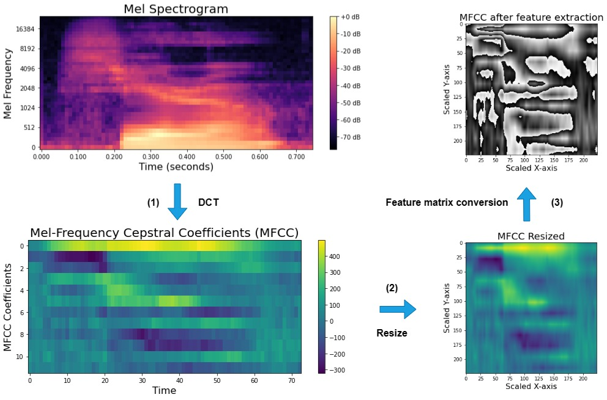
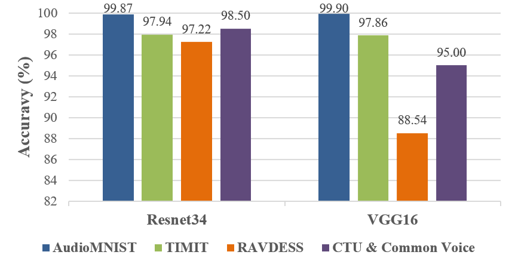
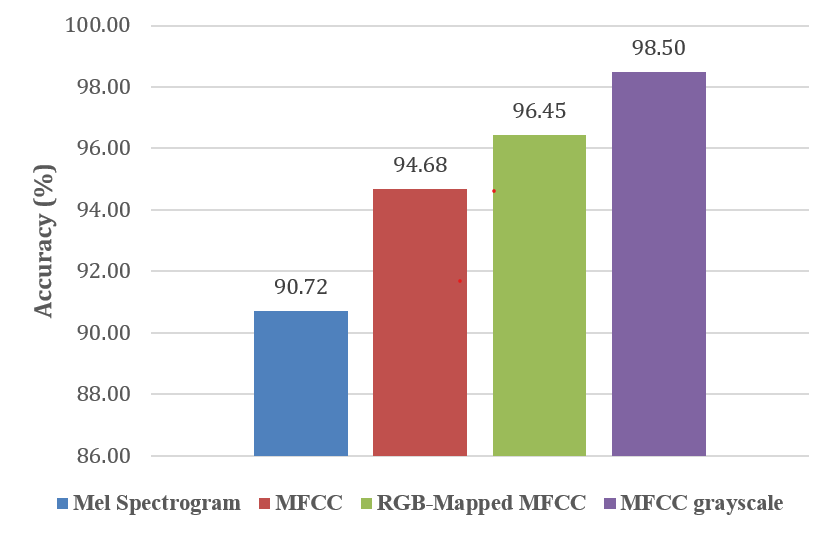
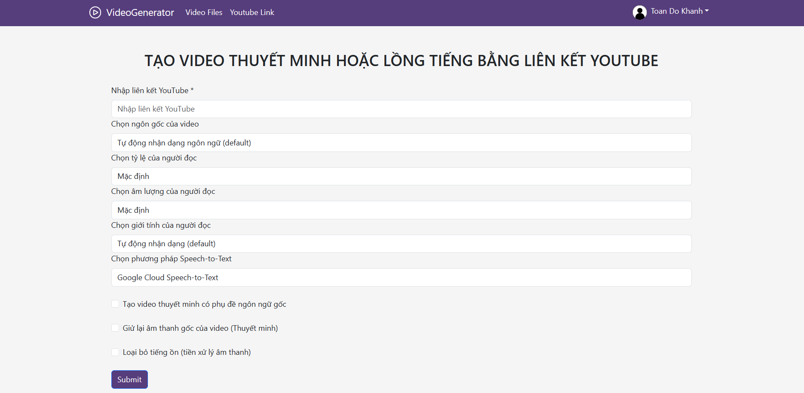
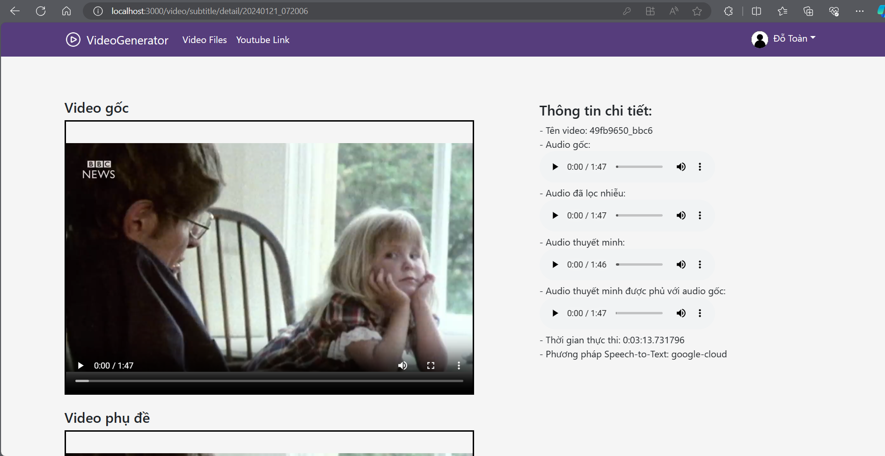
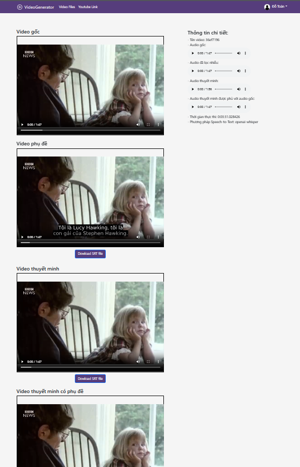
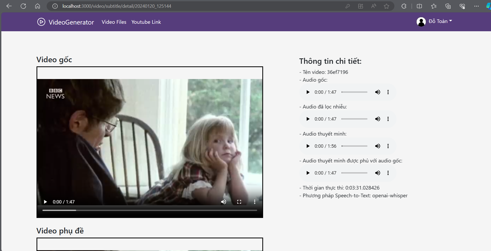

# Vietnamese video dubbing and narration

A 2024 thesis prototype combining speech recognition, translation, voice-label classification and Vietnamese speech synthesis to produce subtitled, dubbed and narrated videos. The research compares VGG16 and ResNet34 with audio features represented as MFCC images.

The male/female categories refer to labels supplied by the research datasets and the voice-selection experiment. They do not establish an individual speaker's gender identity.

## Repository guide

- `Gender-Classification/Code/`: data preprocessing and model experiments.
- `Gender-Classification/Results/`: experimental tables and analysis notebooks.
- `Web/client/`: React user interface.
- `Web/server/`: Express API and Python media worker.
- `images/`, `videos/`: selected figures and demo outputs.

The current maintenance branch is `main`, combining the previous `deverlop` branch and the older `main` history. Default-branch configuration on GitHub is managed separately by the owner.

## Models and data

Trained models and pretrained checkpoints have been separated from the source tree. [ARTIFACTS.md](ARTIFACTS.md) explains restoration; [artifacts.json](artifacts.json) records expected paths and SHA-256 hashes. No public model download is currently configured. Obtain datasets under their own distribution terms; the dataset citations below do not grant redistribution rights.

Notebook outputs have been cleared; selected figures and historical results remain below. The model training and benchmark numbers have not been reproduced in the maintenance pass.

## Local web configuration

Copy `Web/server/.env.example` to `Web/server/.env`. Set distinct random `ACCESS_TOKEN_SECRET` and `FLASK_SERVICE_TOKEN` values (at least 32 characters), a local MongoDB URL and any speech/translation credentials you own. Do not put secrets into client configuration.

With the original dependencies configured, the development entry points are:

```sh
# From Web/server/
npm start
# In a separate terminal, from Web/server/
python3 python_scripts/app.py
# From Web/client/
npm start
```

The worker binds to loopback and requires the service token on requests from Express. The audio pipeline also requires FFmpeg, trusted model artifacts, appropriate system libraries and the historical Python dependencies. Those dependencies have not been installed or validated against current provider APIs during cleanup.

Uploads require login, use server-generated names and have a 256 MiB limit. Result access and deletion check the video owner. Sessions expire after one hour. The browser uses an HttpOnly session cookie for protected media; use `localhost` consistently for frontend and backend in local development, or configure matching secure origins in deployment.

## Historical research and demos

## Gender classification using deep learning methods
We propose a process. The first step is to apply audio preprocessing, which includes methods such as Noise Reduction, Audio Extraction, and Matched Audio Filtering. Next, we use the MFCC (Mel Frequency Cepstral Cofactors) image preprocessing method. Finally, the input data are fed into the VGG16 and ResNet34 gender classification models. The model is trained to predict gender based on the extracted audio features. The output of the model is a gender label, representing "male" or "female". This process integrates multiple information steps, helping us effectively extract audio features to achieve accurate results in gender classification.

.jpg)


#### MFCC preprocessing steps



## Results of gender classification model

#### Source of data sets
- AudioMNIST: Becker, S., Vielhaben, J., Ackermann, M., M ̈uller, K.-R., Lapuschkin, S., Samek, W.: Audiomnist:  xploring explainable artificial intelligence for audio analysis on a simple benchmark. Journal of the Franklin Institute
361(1), 418–428 (2024)
- TIMIT: Garofolo, J., Lamel, L., Fisher, W., Fiscus, J., Pallett, D., Dahlgren, N., Zue, V.: Timit acoustic-phonetic continuous speech corpus. Linguistic
Data Consortium (1992)
- RAVDESS: Livingstone, S.R., Russo, F.A.: The ryerson audio-visual database of emo-tional speech and song (ravdess): A dynamic, multimodal set of facial and vocal expressions in north american english. PLOS ONE 13(5), 0196391 (2018)
- CTU & COMMON: Nguyen, H.T., Thanh, T.N.L., Ngoc, T.L., Le, A.D., Tran, D.T.: Eval-uation on noise reduction in subtitle generator for videos. In: Innova-tive Mobile and Internet Services in Ubiquitous Computing, pp. 140–150. Springer (2022)



## User Interface Design





## Result Video
- [Original video](videos/45c723dd.mp4)
- [Video subtitles](videos/45c723dd_subtitle.mp4)
- [Video narrated](videos/45c723dd_audiodescribed.mp4)
- [Narrated video with original subtitles](videos/45c723dd_audiodescribed_explanation.mp4)
- [Video dubbed](videos/a81a62bf_audiodescribed.mp4)
- [dubbed video with original subtitles](videos/a81a62bf_audiodescribed_explanation.mp4)
## Demo
- Video dubbed:

    [](https://www.youtube.com/watch?v=wLxSIL7UOUA)

- Video narrated:

    [](https://www.youtube.com/watch?v=uIyh93FBa2U)

- Thesis defense (May 15, 2024):

    [](https://www.youtube.com/watch?v=MAtX8bfNNy4)


## Scope and attribution

This repository preserves thesis experiments and a demonstration interface. It is not a production media-processing service. See [third-party notices](THIRD_PARTY_NOTICES.md) and [security configuration](SECURITY.md).
